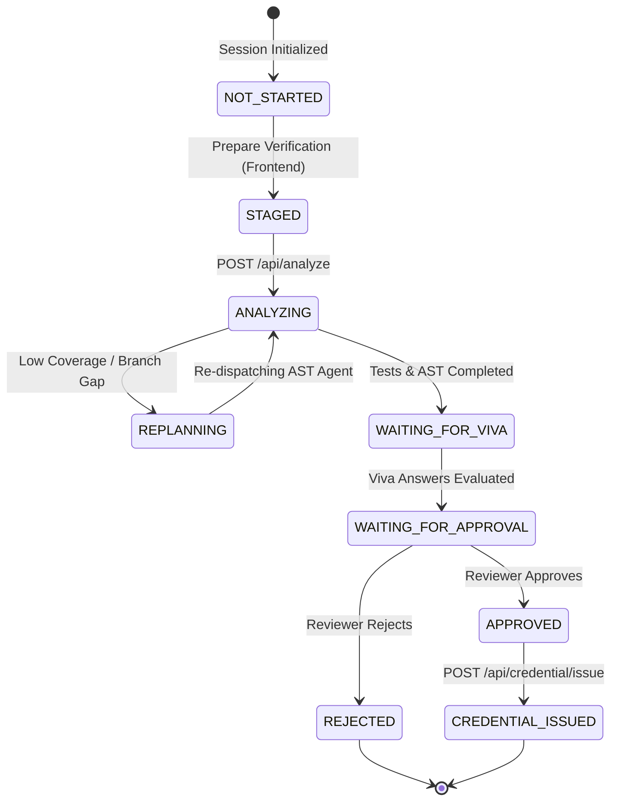

# 📡 SkillProof AI — Complete API Reference & Integration Contract

> **Scope**: Official REST API specification governing communication between the **Frontend Client (Laptop 2)** and the **FastAPI Backend Execution Engine (Laptop 1)**.

---

## 1. Overview & Connection Architecture

The frontend client communicates with the backend via asynchronous JSON HTTP requests over `http://<BACKEND_HOST>:8000`.

- **Base URL (Default)**: `http://127.0.0.1:8000`
- **Configurable via**: Environment variable `SKILLPROOF_BACKEND_URL` or UI Sidebar under **Backend IP / Port**.
- **Default Timeout**: 10 seconds (configurable via `SKILLPROOF_API_TIMEOUT`).
- **Data Exchange Format**: `application/json; charset=utf-8`.

---

## 2. API Endpoints Master Table

| Method | Endpoint | Handler Method (`APIClient`) | Purpose | Request Body | Response Status |
| :--- | :--- | :--- | :--- | :--- | :--- |
| `GET` | `/health` | `check_health()` | Backend liveness and readiness probe | None | `200 OK` |
| `POST` | `/api/analyze` | `start_analysis()` | Dispatches autonomous multi-agent pipeline | `AnalysisRequest` | `202 Accepted` |
| `GET` | `/api/session/{session_id}` | `get_session()` | Retrieves active verification state and metrics | None | `200 OK` |
| `GET` | `/api/session/{session_id}/timeline` | `get_timeline()` | Fetches agent execution DAG trajectory | None | `200 OK` |
| `GET` | `/api/session/{session_id}/evidence` | `get_evidence()` | Fetches granular AST and test evidence cards | None | `200 OK` |
| `GET` | `/api/session/{session_id}/report` | `get_report()` | Fetches audit dossier for human reviewer | None | `200 OK` |
| `GET` | `/api/viva/{session_id}/questions` | `get_viva_questions()` | Fetches 3 code-specific viva interview inquiries | None | `200 OK` |
| `POST` | `/api/viva/{session_id}/answer` | `submit_viva_answer()` | Submits candidate viva response for AI evaluation | `VivaAnswerRequest` | `200 OK` |
| `POST` | `/api/approve/{session_id}` | `submit_approval()` | Formal human reviewer sign-off gate | `ApprovalRequest` | `200 OK` |
| `POST` | `/api/credential/{session_id}/issue`| `issue_credential()` | Generates HMAC-SHA256 signed credential | None | `201 Created` |
| `GET` | `/api/credential/{credential_id}` | `get_credential()` | Fetches issued credential record | None | `200 OK` |
| `POST` | `/api/credential/verify` | `verify_credential()` | Verifies cryptographic signature against payload | `VerificationRequest` | `200 OK` |
| `GET` | `/api/credential/{credential_id}/verify`| Fallback Verification | Fallback route for verification status | None | `200 OK` |

---

## 3. Detailed Endpoint Specifications

### 1. Health Probe (`GET /health`)
- **Purpose**: Verify backend uptime and network reachability.
- **Request**: No parameters.
- **Response `200 OK`**:
```json
{
  "status": "healthy",
  "version": "1.0.0",
  "timestamp": "2026-10-31T12:00:00Z",
  "components": {
    "langgraph": "online",
    "chromadb": "online",
    "gemini_api": "connected",
    "sqlite": "writable"
  }
}
```

---

### 2. Start Verification Pipeline (`POST /api/analyze`)
- **Purpose**: Clones the candidate repository, pins the commit SHA, initializes the LangGraph state graph, and begins background analysis.
- **Request Body (`AnalysisRequest`)**:
```json
{
  "candidate_id": "CAND-2026-X81",
  "repo_url": "https://github.com/candidate/target-repo",
  "claimed_skills": ["Python", "Machine Learning", "OOP", "Testing"],
  "description": "Fraud detection model pipeline using scikit-learn and pytest."
}
```
- **Validation Rules**:
  - `candidate_id`: String, $\ge 2$ characters, non-empty.
  - `repo_url`: Must be a valid public HTTPS GitHub repository URL (`https://github.com/owner/repo`).
  - `claimed_skills`: Array of strings matching supported skills taxonomy.
- **Response `202 Accepted`**:
```json
{
  "session_id": "sess_CAND-2026-X81_1730376000",
  "candidate_id": "CAND-2026-X81",
  "repo_url": "https://github.com/candidate/target-repo",
  "commit_sha": "e4b971a8f9c08d234a11b6f0e9e4a8f9d0c2b1e7",
  "status": "ANALYZING",
  "message": "Autonomous multi-agent verification pipeline dispatched."
}
```

---

### 3. Poll Session Status (`GET /api/session/{session_id}`)
- **Purpose**: Polled periodically by the frontend to observe agent progress and retrieve final results.
- **Response `200 OK`**:
```json
{
  "session_id": "sess_CAND-2026-X81_1730376000",
  "candidate_id": "CAND-2026-X81",
  "repo_url": "https://github.com/candidate/target-repo",
  "status": "WAITING_FOR_VIVA",
  "approval_status": "pending",
  "repo_info": {
    "repo_name": "target-repo",
    "commit_sha": "e4b971a8f9c08d234a11b6f0e9e4a8f9d0c2b1e7",
    "default_branch": "main",
    "languages": {"Python": 98.4, "Shell": 1.6},
    "dependencies": ["torch>=2.1.0", "scikit-learn>=1.3.0", "pytest>=7.4.0"],
    "discovered_modules": ["core", "uncertainty", "tests"]
  },
  "skill_assessment": {
    "overall_score": 94,
    "verdict": "VERIFIED",
    "confidence": "High",
    "skills": {
      "Python": {"impl_score": 96, "test_score": 95, "viva_score": 96, "verdict": "VERIFIED"},
      "Machine Learning": {"impl_score": 95, "test_score": 94, "viva_score": 97, "verdict": "VERIFIED"}
    }
  }
}
```

---

### 4. Fetch Technical Viva Questions (`GET /api/viva/{session_id}/questions`)
- **Purpose**: Retrieves 3 targeted architectural interview questions synthesized by Gemini from the candidate's actual AST code.
- **Response `200 OK`**:
```json
{
  "session_id": "sess_CAND-2026-X81_1730376000",
  "questions": [
    {
      "id": "Q1",
      "question": "In `model.py`, why did you implement class_weight='balanced' in RandomForestClassifier rather than SMOTE oversampling?",
      "difficulty": "Advanced",
      "source_file": "model.py",
      "function": "__init__",
      "context": "Fraud detection dataset has a severe 94:6 class imbalance.",
      "expected_concepts": ["Cost-sensitive learning", "Boundary distortion avoidance", "Computational efficiency"]
    }
  ]
}
```

---

### 5. Submit Viva Response (`POST /api/viva/{session_id}/answer`)
- **Purpose**: Submits candidate response for AI evaluation against expected concepts and retrieved code context.
- **Request Body (`VivaAnswerRequest`)**:
```json
{
  "question_id": "Q1",
  "answer": "Using balanced class weights dynamically penalizes minority class errors inversely proportional to class frequencies during split criteria calculation, avoiding the artificial synthetic neighbor distortion associated with SMOTE in sparse spaces."
}
```
- **Response `200 OK`**:
```json
{
  "question_id": "Q1",
  "evaluation": {
    "technical_correctness": 96,
    "understanding": 98,
    "reasoning": 95,
    "evidence_alignment": 97,
    "limitations_awareness": 92,
    "overall_score": 96.0,
    "feedback": "Superb conceptual articulation of cost-sensitive learning mechanics.",
    "follow_up": "How did you calibrate the decision threshold for the resulting probabilities?"
  }
}
```

---

### 6. Reviewer Formal Sign-Off (`POST /api/approve/{session_id}`)
- **Purpose**: Human-in-the-loop audit sign-off gate before credential issuance is unlocked.
- **Request Body (`ApprovalRequest`)**:
```json
{
  "decision": "approved",
  "reviewer_notes": "Code AST reflects authentic software engineering. Unit tests pass cleanly. Viva demonstrates deep conceptual ownership.",
  "reviewer_id": "auditor_lead_01"
}
```
- **Response `200 OK`**:
```json
{
  "session_id": "sess_CAND-2026-X81_1730376000",
  "approval_status": "approved",
  "reviewer_id": "auditor_lead_01",
  "timestamp": "2026-10-31T12:15:00Z",
  "message": "Candidate officially approved. Verifiable credential issuance unlocked."
}
```

---

### 7. Issue Verifiable Credential (`POST /api/credential/{session_id}/issue`)
- **Purpose**: Computes HMAC-SHA256 cryptographic signature and returns the verifiable credential payload.
- **Validation**: Requires `approval_status == 'approved'`. Returns `403 Forbidden` if human approval is missing.
- **Response `201 Created`**:
```json
{
  "credential": {
    "credential_id": "SP-CRED-2026-X81-01",
    "data": {
      "credential_id": "SP-CRED-2026-X81-01",
      "candidate_id": "CAND-2026-X81",
      "repo_url": "https://github.com/candidate/target-repo",
      "commit_sha": "e4b971a8f9c08d234a11b6f0e9e4a8f9d0c2b1e7",
      "verified_skills": [
        {"skill": "Python", "score": 96, "verdict": "VERIFIED"},
        {"skill": "Machine Learning", "score": 95, "verdict": "VERIFIED"}
      ],
      "overall_evidence_score": 94,
      "viva_average_score": 96.0,
      "issue_timestamp": "2026-10-31T12:20:00Z",
      "issuer": "SkillProof AI Verification Authority (Grand Finale Edition)",
      "signature_algorithm": "HMAC-SHA256",
      "status": "VALID"
    },
    "signature": "3f8b89c0a1e4d56789123456789abcdef0123456789abcdef0123456789abcde",
    "status": "VALID"
  }
}
```

---

### 8. Verify Credential (`POST /api/credential/verify`)
- **Purpose**: Employer verification endpoint checking if credential payload matches the cryptographic signature.
- **Request Body (`VerificationRequest`)**:
```json
{
  "credential_id": "SP-CRED-2026-X81-01",
  "candidate_id": "CAND-2026-X81",
  "signature": "3f8b89c0a1e4d56789123456789abcdef0123456789abcdef0123456789abcde",
  "data": { ... }
}
```
- **Response `200 OK` (Valid)**:
```json
{
  "status": "VALID",
  "valid": true,
  "credential_id": "SP-CRED-2026-X81-01",
  "candidate_id": "CAND-2026-X81",
  "message": "Cryptographic signature verified against canonical payload."
}
```
- **Response `200 OK` (Tampered / Invalid)**:
```json
{
  "status": "INVALID",
  "valid": false,
  "credential_id": "SP-CRED-2026-X81-01",
  "message": "HMAC-SHA256 signature mismatch. The credential payload has been modified or forged."
}
```

---

## 4. Session State Machine & Lifecycle Transitions


