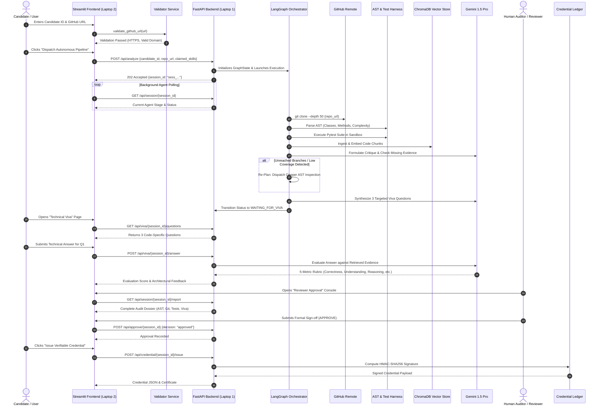

# 🏛️ SkillProof AI — Complete System Architecture Specification

> **Platform Architecture**: SkillProof AI is an enterprise-grade autonomous skill verification platform for the **Agentic AI Hackathon 2026 Grand Finale (Problem 08)**. It establishes a verifiable bridge between candidate claims and physical source code through compiler-level AST parsing, isolated test execution, Git forensics, code-grounded technical viva interviews, and cryptographically signed credentials.

---

## 1. Master System Topology (Two-Node Distributed Model)

SkillProof AI separates client-facing telemetry and user interaction from heavy code analysis and sandboxing across a **two-node distributed network**:

```mermaid
graph TB
    subgraph NODE 2: FRONTEND CLIENT (Streamlit • Laptop 2 • Port 8501)
        direction TB
        subgraph UI_LAYER["1. Presentation & Page Routing Layer"]
            P_OVER["Overview & Dynamic Input"]
            P_WORKSPACE["Autonomous Agent Workspace"]
            P_REPO["Repository Intelligence & AST Inspector"]
            P_GIT["Git Forensics & Cadence"]
            P_EVID["Skill Evidence Explorer"]
            P_VIVA["Interactive Technical Viva Q&A"]
            P_AUDIT["Reviewer Approval Gate"]
            P_CRED["Credentials & Tamper Sandbox"]
            P_EVAL["16-Case Benchmark Lab"]
        end

        subgraph STATE_LAYER["2. State & Session Management Layer"]
            SM["SessionManager (In-Memory session_state)"]
            CANON["Canonical JSON Serializer"]
            CRYPTO_CLI["HMAC-SHA256 Client Verifier"]
        end

        subgraph SERVICE_LAYER["3. Services & Integration Layer"]
            VAL["Input Validator (Strict HTTPS & Regex)"]
            AC["APIClient (HTTP REST Client • requests)"]
        end

        UI_LAYER --> STATE_LAYER
        UI_LAYER --> SERVICE_LAYER
    end

    subgraph NETWORK_BOUNDARY["HTTP REST JSON Communication Contract (Port 8000)"]
        direction LR
        REQ["POST /api/analyze<br/>GET /api/session/{id}<br/>POST /api/viva/answer<br/>POST /api/approve<br/>POST /api/credential/issue"]
    end

    subgraph NODE 1: BACKEND INTELLIGENCE ENGINE (FastAPI • Laptop 1 • Port 8000)
        direction TB
        subgraph API_GATEWAY["1. API Routing & Middleware Layer"]
            FASTAPI["FastAPI ASGI Server (Uvicorn)"]
            CORS["CORS Middleware"]
            SCHEMAS["Pydantic Request/Response Models"]
        end

        subgraph AGENT_SWARM["2. Agentic Orchestration Layer (LangGraph)"]
            GRAPH["StateGraph(GraphState)"]
            PLANNER["Master Planner Node"]
            CRITIQUE["Critique & Evaluation Node"]
            REPLAN["Adaptive Re-Planning Loop"]
            CHECKPOINT["Human Approval Checkpoint Interrupt"]
        end

        subgraph TOOL_ENGINE["3. Static Code Analysis & Test Execution Engine"]
            AST_ENG["Python AST Parser (Complexity, Signatures)"]
            GIT_ENG["GitPython Forensics (Diffs, Burst Detection)"]
            SANDBOX["Sandboxed Pytest Runner (15s Timeout Isolation)"]
        end

        subgraph RAG_LAYER["4. RAG & Vector Retrieval Layer"]
            SPLITTER["AST-Aware Semantic Code Splitter"]
            EMBED["Embedding Model (text-embedding-004)"]
            CHROMA[("ChromaDB Vector Store (Namespaced by Session)")]
        end

        subgraph LLM_INTELLIGENCE["5. Foundation Model Intelligence Layer"]
            GEMINI["Google Gemini 1.5 Pro / Flash"]
            PROMPTS["Structured System & Rubric Prompts"]
        end

        subgraph PERSISTENCE_LAYER["6. Persistence & Cryptographic Ledger"]
            SQLITE[("SQLite Database (skillproof.db)")]
            SAVER[("LangGraph SqliteSaver Checkpointer")]
            HMAC_SIGN["HMAC-SHA256 Credential Signer"]
        end

        FASTAPI --> AGENT_SWARM
        AGENT_SWARM --> TOOL_ENGINE
        AGENT_SWARM --> RAG_LAYER
        AGENT_SWARM --> LLM_INTELLIGENCE
        AGENT_SWARM --> PERSISTENCE_LAYER
    end

    SERVICE_LAYER -- "JSON Payloads over Wi-Fi / LAN" --> NETWORK_BOUNDARY
    NETWORK_BOUNDARY --> API_GATEWAY
```

---

## 2. Frontend Architecture (Laptop 2 • Streamlit Client)

The frontend client running at `http://localhost:8501` is structured around 5 decoupled subsystems:

### 1. Presentation Layer (`components/` & `pages/`)
Organized into 12 modular sub-systems:
- **`dashboard.py` (`Overview`)**: Real-time candidate entry form with empty initial inputs, HTTPS validation, "OPEN REPOSITORY" action, and "PREPARE VERIFICATION" staging card.
- **`agent_timeline.py` (`Agent Workspace`)**: Renders real-time telemetry from the 7-stage multi-agent DAG: `Plan → Act → Observe → Critique → Re-Plan → Act Again → Verify`.
- **`repository_explorer.py` (`Repository Intelligence`)**: Displays target repo parameters, branch metadata, discovered package modules, and language breakdown.
- **`code_inspector.py`**: Static AST decomposition showing extracted classes, method signatures, top-level imports, and cyclomatic complexity.
- **`evidence_graph.py` (`Evidence Explorer`)**: Granular evidence cards mapping claimed skills to AST line ranges, passing unit tests, and structural findings.
- **`git_analysis.py` (`Git Forensics`)**: Interactive Plotly charts analyzing commit code diff distributions (additions vs. deletions) and historical development cadence.
- **`originality_analysis.py`**: AST structural fingerprint comparison against standard library idioms and boilerplate patterns.
- **`skill_assessment.py`**: Dual-axis Plotly radar chart comparing **static code implementation** against **candidate viva comprehension**.
- **`viva_interface.py` (`Technical Viva`)**: Interactive interview suite rendering code-specific inquiries and 5-metric AI evaluation scorecards.
- **`reviewer_console.py` (`Reviewer Approval`)**: Mandatory human auditor gate enforcing explicit `APPROVE` or `REJECT` sign-off before credential issuance.
- **`credential_viewer.py` (`Credentials`)**: Verifiable credential display, JSON certificate download, employer verification portal, and live cryptographic tamper test.
- **`evaluation_dashboard.py` (`Evaluation Lab`)**: 16-case benchmark metrics, $2 \times 2$ Confusion Matrix, and case-by-case test ledger.

### 2. State & Session Management (`services/session_manager.py`)
- Provides reactive state isolation using Streamlit's `st.session_state`.
- `get_empty_session()` ensures clean application startup with zero synthetic or hardcoded candidate data.
- Handles client-side canonical serialization and cryptographic verification.

### 3. Services & Integration Layer (`services/api_client.py` & `validators.py`)
- **`validators.py`**: Validates URLs for strict HTTPS schemes, whitelisted hostnames (`github.com`), path structures (`owner/repo`), and rejects deceptive domains (`github.com.example.com`).
- **`api_client.py`**: Robust HTTP client for all backend REST endpoints with configurable timeouts and uniform error extraction.

### 4. Client-Side Cryptographic Verifier
- Implements `compute_signature()` and `verify_signature()` using `hmac.new(..., hashlib.sha256)` to execute independent tamper detection on Laptop 2.

### 5. Automated Benchmark Harness (`evaluation/run_evaluation.py`)
- Evaluates 16 deterministic benchmark test vectors, calculating accuracy, precision, recall, and F1 scores.

---

## 3. Backend Architecture (Laptop 1 • FastAPI Intelligence Node)

The backend runs on Laptop 1 at `http://127.0.0.1:8000`:

### 1. API Gateway & Validation Layer (FastAPI)
- Handles incoming HTTP requests with CORS middleware enabled for cross-laptop network communication.
- Enforces strict Pydantic schema validation:
  - `AnalysisRequest`: Validates candidate ID, repo URL, claimed skills, and description.
  - `VivaAnswerRequest`: Validates question ID and natural language candidate answer.
  - `ApprovalRequest`: Validates auditor ID, decision (`approved` / `rejected`), and review notes.

### 2. Multi-Agent Orchestration Layer (LangGraph)
Governed by an immutable state dictionary (`GraphState`):
- **Master Planner (`dag_planner`)**: Decomposes claimed skills against discovered repository structure.
- **Critique & Evaluation Node (`critique_node`)**: Inspects test coverage and missing evidence.
- **Adaptive Re-Planning Loop (`re_planner`)**: If unit test coverage is $< 70\%$ and iteration count $< 3$, the graph loops back to dispatch deeper AST inspection.
- **Human Reviewer Gate**: Enforces a LangGraph `interrupt_before=["credential_issuer"]` checkpoint, preventing automated credential minting without explicit human sign-off.

### 3. Static Analysis & Sandboxing Engine
- **AST Parser (`ast`)**: Compiler-level parsing of classes, method signatures, and cyclomatic complexity:
  $$M = E - N + 2P$$
- **Git Forensics (`GitPython`)**: Clones repository (`depth=50`), audits commit cadence, and detects single-commit bulk paste dumps.
- **Sandboxed Test Runner (`pytest`)**: Runs candidate unit tests in an isolated execution sandbox with a 15-second execution timeout.

### 4. RAG Retrieval Layer (ChromaDB)
- **AST-Aware Semantic Splitter**: Chunks code along class and function definitions, preserving line boundaries (`L43-L76`).
- **Embedding Model**: Google `text-embedding-004` (768 dimensions).
- **Session-Isolated ChromaDB**: Vector collections enforce mandatory metadata filtering (`where={"session_id": session_id}`) to prevent cross-candidate data leakage.

### 5. LLM Intelligence Layer (Google Gemini 1.5)
- **Viva Synthesis Engine**: Generates 3 targeted interview questions referencing the candidate's actual function names and mathematical implementations.
- **AI Rubric Evaluator**: Evaluates candidate answers across 5 metrics: Technical Correctness, Understanding, Reasoning, Evidence Alignment, and Limitations.

### 6. Persistence & Credential Signer
- **SQLite Database (`skillproof.db`)**: Persists sessions, evidence records, viva questions, and audit logs with Write-Ahead Logging (WAL) enabled.
- **LangGraph Checkpointer (`SqliteSaver`)**: Saves execution state snapshots, enabling thread resumption across server restarts.
- **HMAC Signer**: Calculates 64-character SHA256 hex signatures over canonical credential JSON payloads.

---

## 4. End-to-End Application Data Flow



---

## 5. Network Communication Contract (Laptop 2 $\leftrightarrow$ Laptop 1)

| Method | Endpoint | Request Payload | Response Payload | Status Code |
| :--- | :--- | :--- | :--- | :--- |
| `GET` | `/health` | None | `{ "status": "healthy", "langgraph": "online" }` | `200 OK` |
| `POST` | `/api/analyze` | `{ candidate_id, repo_url, claimed_skills }` | `{ session_id: "sess_...", status: "ANALYZING" }` | `202 Accepted` |
| `GET` | `/api/session/{id}` | None | `{ status, repo_info, ast_metrics, skill_scores }` | `200 OK` |
| `GET` | `/api/viva/{id}/questions` | None | `{ questions: [ { id, question, function, context } ] }` | `200 OK` |
| `POST` | `/api/viva/{id}/answer` | `{ question_id, answer }` | `{ evaluation: { overall_score, feedback } }` | `200 OK` |
| `POST` | `/api/approve/{id}` | `{ decision: "approved", reviewer_notes }` | `{ approval_status: "approved" }` | `200 OK` |
| `POST` | `/api/credential/{id}/issue` | None | `{ credential_id, data: {...}, signature: "..." }` | `201 Created` |
| `POST` | `/api/credential/verify` | `{ credential_id, signature, data }` | `{ status: "VALID", valid: true }` | `200 OK` |

---

## 6. Cryptographic Credential Ledger Specification

SkillProof AI issues verifiable credentials signed with **HMAC-SHA256**:

```python
import hmac
import hashlib
import json

def compute_signature(payload: dict, secret_key: str) -> str:
    # Deterministic alphabetical key ordering
    canonical = json.dumps(payload, sort_keys=True)
    return hmac.new(
        secret_key.encode("utf-8"),
        canonical.encode("utf-8"),
        hashlib.sha256
    ).hexdigest()
```

### Tamper Rejection Invariant
Modifying any attribute in the credential payload (e.g., altering `score: 75` to `score: 99`, or modifying the `candidate_id`) causes the recomputed digest to mismatch:
$$\text{HMAC-SHA256}(K, \text{Payload}_{\text{tampered}}) \neq \text{Signature}_{\text{original}}$$
The verification engine rejects the credential immediately with `status: "INVALID"`.

---

## 7. Security Architecture & Threat Boundaries

1. **SSRF Protection**: Whitelists `github.com` exclusively; enforces HTTPS-only schemes; rejects deceptive subdomains (`github.com.attacker.com`).
2. **Untrusted Code Execution**: Pytest execution is isolated in dedicated subprocesses with strict 15-second execution timeouts. Production roadmap uses stateless Docker containers (`--network none`, `--read-only`, `CAP_DROP=ALL`).
3. **Multi-Tenancy Vector Isolation**: ChromaDB vector queries enforce mandatory `$and` metadata filtering on `session_id` and `commit_sha`.
4. **Approval Gate Security**: Backend route `POST /api/credential/issue` returns `403 Forbidden` if `approval_status != 'approved'`.
