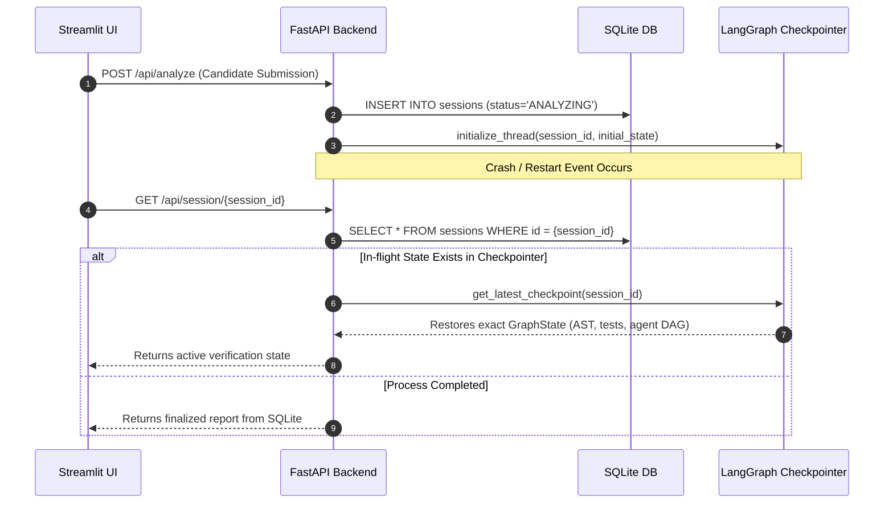

# 🗄️ SkillProof AI — Complete Database & Persistence Architecture Guide

> **Core Concept**: SkillProof AI uses a hybrid multi-tier persistence model: structured relational data in SQLite, agent state checkpoints in LangGraph's checkpointer store, dense vector embeddings in ChromaDB, and reactive client state in Streamlit's Session Manager.

---

## 1. Multi-Tier Persistence Model

```mermaid
graph TD
    subgraph Client Tier (Laptop 2)
        ST_STATE["Streamlit session_state (In-Memory)"]
    end

    subgraph Backend Persistence Tiers (Laptop 1)
        SQLITE[("SQLite Relational Database (skillproof.db)")]
        CHECKPOINT[("LangGraph Checkpoint Store (SqliteSaver)")]
        CHROMA[("ChromaDB Vector Store (DuckDB / Parquet)")]
        FS[("Ephemeral File System Workspace (/tmp/skillproof_*)")]
    end

    ST_STATE -- "HTTP REST Sync" --> SQLITE
    SQLITE --- CHECKPOINT
    CHECKPOINT -- "State Snapshots" --> FS
    CHROMA -- "Vector Index" --> FS
```

---

## 2. Relational Database Schema Map (SQLite)

In the backend on Laptop 1, relational entities are managed using SQLAlchemy models:

| Table Name | Purpose | Key Fields | Relationships |
| :--- | :--- | :--- | :--- |
| **`sessions`** | Master verification session records | `id` (PK, String), `candidate_id`, `repo_url`, `commit_sha`, `status`, `created_at`, `updated_at` | 1-to-many with `evidence_cards`, `viva_questions`, `audit_logs`; 1-to-1 with `credentials`. |
| **`evidence_cards`** | Granular observations linking skills to code | `id` (PK), `session_id` (FK), `skill_name`, `classification`, `file_path`, `line_range`, `snippet`, `test_reference`, `confidence` | Belongs to `sessions`. |
| **`viva_questions`** | Synthesized interview questions & candidate answers | `id` (PK), `session_id` (FK), `question_text`, `difficulty`, `source_file`, `function_name`, `candidate_answer`, `score`, `evaluation_json` | Belongs to `sessions`. |
| **`audit_logs`** | Chronological agent telemetry & re-planning traces | `id` (PK), `session_id` (FK), `stage`, `agent_name`, `tool_name`, `observation`, `timestamp` | Belongs to `sessions`. |
| **`credentials`** | Issued cryptographic certificates | `id` (PK), `session_id` (FK, Unique), `candidate_id`, `repo_url`, `commit_sha`, `payload_json`, `hmac_signature`, `issued_at`, `status` | Belongs to `sessions`. |

---

## 3. Storage Systems Compared

| Dimension | SQLite (`skillproof.db`) | LangGraph Checkpointer | ChromaDB Vector Store | Streamlit Session State |
| :--- | :--- | :--- | :--- | :--- |
| **Storage Engine** | SQLite3 relational engine | SQLite key-value blob store (`SqliteSaver`) | DuckDB + Parquet flat files | Python runtime memory (Laptop 2) |
| **Data Stored** | Sessions, evidence, approvals, credentials | `GraphState` thread execution snapshots | Code chunk vectors & metadata | Active candidate inputs, UI tab selection |
| **Persistence Scope** | Permanent across restarts | Durable per `thread_id` | Cached per repo commit SHA | Ephemeral to browser session |
| **Isolation Mechanism**| `session_id` Foreign Keys | `thread_id` partitioning | Metadata `$and` filtering | Browser cookie session |

---

## 4. Assessment Record Lifecycle & Session Recovery



---

## 5. Persistence Gaps & Concurrency Protections

1. **SQLite Write Concurrency (WAL Mode)**:
   - SQLite operates under single-writer locking. To handle concurrent agent writes and API polling, the backend must enable **Write-Ahead Logging (WAL)**:
     ```sql
     PRAGMA journal_mode = WAL;
     PRAGMA busy_timeout = 5000;
     ```
2. **Workspace Cleanup Invariant**:
   - Temporary clone directories (`/tmp/skillproof_{session_id}`) must be protected by `try...finally` cleanup blocks to avoid filling host disk space during long-running hackathon operations.
