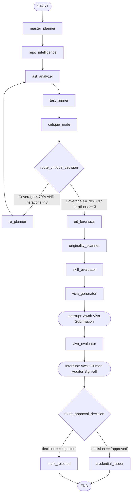

# 🧠 SkillProof AI — Complete LangGraph Agent Architecture & Orchestration Guide

> **Core Concept**: SkillProof AI uses LangGraph to coordinate an autonomous multi-agent verification swarm. Unlike a linear automation script, LangGraph provides stateful transitions, cyclic re-planning when evidence is insufficient, conditional branching based on AST complexity, and genuine human-in-the-loop checkpoints.

---

## 1. Graph State Schema (`GraphState`)

In the backend on Laptop 1, the entire multi-agent lifecycle is governed by an immutable state dictionary typed using Pydantic or `typing.TypedDict`:

```python
from typing import Annotated, Dict, List, Optional, Any
from typing_extensions import TypedDict
import operator

class GraphState(TypedDict):
    # Session & Candidate Identifiers
    session_id: str
    candidate_id: str
    repo_url: str
    commit_sha: str
    claimed_skills: List[str]
    description: str

    # Repository & Static Code Audit State
    workspace_path: str
    discovered_modules: List[str]
    code_files: Dict[str, str]
    ast_metrics: Dict[str, Any]
    cyclomatic_average: float

    # Test Execution & Coverage State
    test_cases_discovered: int
    test_cases_passed: int
    test_cases_failed: int
    test_coverage_pct: float
    test_telemetry: Dict[str, Any]

    # Git Provenance & Forensics
    commit_history: List[Dict[str, Any]]
    author_provenance_verified: bool
    is_single_commit_dump: bool

    # Multi-Agent Iteration & Re-Planning Telemetry
    # operator.add ensures append-only history tracking across graph passes
    agent_trajectory: Annotated[List[Dict[str, Any]], operator.add]
    iteration_count: int
    max_iterations: int
    replan_triggered: bool

    # Evidence, Assessment & Viva State
    evidence_cards: List[Dict[str, Any]]
    skill_scores: Dict[str, Dict[str, Any]]
    overall_score: int
    viva_questions: List[Dict[str, Any]]
    viva_answers: Dict[str, str]
    viva_evaluations: Dict[str, Any]

    # Checkpoint & Human Gate State
    approval_status: str       # "pending", "approved", "rejected"
    reviewer_notes: str
    reviewer_id: str
    is_credential_issued: bool
    credential_payload: Optional[Dict[str, Any]]
    credential_signature: Optional[str]
    error_log: Annotated[List[str], operator.add]
```

---

## 2. Graph Nodes Master Reference Table

| Node Name | Backend Module | Executing Function | State Input | State Output | Next Routing Target |
| :--- | :--- | :--- | :--- | :--- | :--- |
| **`master_planner`** | `agents/planner.py` | `plan_verification_dag()` | `claimed_skills`, `repo_url` | `agent_trajectory`, `max_iterations` | `repo_intelligence` |
| **`repo_intelligence`** | `agents/repo_inspector.py` | `clone_and_inspect_tree()` | `repo_url`, `workspace_path` | `commit_sha`, `discovered_modules`, `code_files` | `ast_analyzer` |
| **`ast_analyzer`** | `agents/ast_agent.py` | `parse_ast_signatures()` | `code_files`, `claimed_skills` | `ast_metrics`, `cyclomatic_average` | `test_runner` |
| **`test_runner`** | `agents/test_runner.py` | `run_sandboxed_pytest()` | `workspace_path`, `code_files` | `test_cases_passed`, `test_coverage_pct` | `critique_node` |
| **`critique_node`** | `agents/critique.py` | `evaluate_coverage_gap()` | `ast_metrics`, `test_coverage_pct` | `replan_triggered`, `iteration_count` | Conditional Branch (Replan vs Git) |
| **`re_planner`** | `agents/replan.py` | `formulate_secondary_dag()`| `ast_metrics`, `iteration_count` | `agent_trajectory`, `iteration_count` | `ast_analyzer` (Loopback) |
| **`git_forensics`** | `agents/git_forensics.py` | `audit_provenance()` | `workspace_path`, `commit_sha` | `commit_history`, `is_single_commit_dump` | `originality_scanner` |
| **`originality_scanner`**| `agents/originality.py` | `scan_ast_fingerprints()` | `code_files`, `ast_metrics` | `evidence_cards`, `agent_trajectory` | `skill_evaluator` |
| **`skill_evaluator`** | `agents/skill_eval.py` | `fuse_multisignal_scores()`| `ast_metrics`, `test_telemetry`, `git` | `skill_scores`, `overall_score` | `viva_generator` |
| **`viva_generator`** | `agents/viva_prep.py` | `synthesize_code_inquiries()`| `code_files`, `ast_metrics` | `viva_questions` | `interrupt_viva` (Human Wait) |
| **`viva_evaluator`** | `agents/viva_eval.py` | `grade_viva_answers()` | `viva_answers`, `viva_questions` | `viva_evaluations`, `skill_scores` | `interrupt_approval` (Auditor Wait) |
| **`credential_issuer`** | `agents/credential.py` | `sign_hmac_credential()` | `skill_scores`, `approval_status` | `credential_payload`, `signature` | `END` |

---

## 3. Graph Routing & Conditional Edges



### Conditional Edge Implementation
```python
def route_critique_decision(state: GraphState) -> str:
    """Evaluate whether evidence is sufficient or if adaptive re-planning is required."""
    coverage = state.get("test_coverage_pct", 0.0)
    iterations = state.get("iteration_count", 0)
    max_iter = state.get("max_iterations", 3)

    # If code coverage is deficient and iteration cap has not been exceeded, loop back
    if coverage < 70.0 and iterations < max_iter:
        return "re_planner"
    return "git_forensics"

def route_approval_decision(state: GraphState) -> str:
    """Enforce strict human reviewer decision gate."""
    decision = state.get("approval_status", "pending")
    if decision == "approved":
        return "credential_issuer"
    return "mark_rejected"
```

---

## 4. LangGraph Execution Explained

### Beginner Explanation (Mental Model)
Imagine a team of specialist audit detectives investigating a developer's software claims:
1. Detective 1 (**Planner**) reads the resume claims and inspects the repository's table of contents.
2. Detective 2 (**AST Inspector**) dissects the code, checking if classes and functions actually exist or are just empty `TODO` comments.
3. Detective 3 (**Test Runner**) runs the unit tests in an isolated cleanroom to verify if the code works.
4. Detective 4 (**Critique Agent**) checks the test report. If an important part of the code wasn't tested, they send Detective 2 back to inspect those unreached files (**Re-Planning**).
5. Detective 5 (**Git Forensics**) audits the commit timeline to make sure the code wasn't pasted in a single 10,000-line dump right before the interview.
6. Detective 6 (**Viva Examiner**) formulates 3 interview questions based on the candidate's actual mathematical functions.
7. The system pauses and waits for the candidate to answer.
8. The Lead Auditor (**Human**) reviews the entire folder and signs off. Only then does the digital certificate get minted.

### Advanced Engineering Explanation (State Machine Mechanics)
1. **Immutable Checkpointed State**: LangGraph maintains state snapshots via a persistent checkpointer (e.g., `SqliteSaver` or `MemorySaver`). Every state transition emits a delta update.
2. **Interrupt & Resume Mechanics**: When reaching `interrupt_viva` or `interrupt_approval`, the graph yields control back to FastAPI without terminating the thread. The state is serialized to SQLite. When the candidate submits an answer (`POST /api/viva/answer`) or the auditor signs off (`POST /api/approve`), FastAPI invokes `graph.resume(thread_id, user_payload)`.
3. **Loop Invariants & Bounded Recursion**: Cyclic edges (`critique_node -> re_planner -> ast_analyzer`) are bounded by `max_iterations = 3` and LangGraph's internal recursion limit `recursion_limit=25`, preventing infinite graph loops.

---

## 5. Fourteen Core Architecture Questions Answered

### 1. Is this a genuinely stateful LangGraph application?
**Yes.** The backend preserves a typed `GraphState` containing intermediate AST dictionaries, test logs, and git commit history across all node transitions.

### 2. Is the workflow dynamic or mostly fixed?
**It is adaptive and dynamic.** While it follows a high-level DAG, routing through `re_planner` is conditional on runtime code coverage and missing evidence.

### 3. Does the LLM actually influence routing?
**Yes.** The Critique agent uses Gemini to evaluate whether missing implementations require secondary inspection, setting `replan_triggered = True`.

### 4. Can the agent select tools?
**Yes.** Agents select tools (`repo_tree_parser`, `ast_code_analyzer`, `pytest_runner`, `git_provenance_auditor`, `ast_similarity_scanner`) via standard tool-calling signatures.

### 5. Are tool calls executed through a controlled registry?
**Yes.** All tools are whitelisted Python functions with strictly validated arguments, preventing arbitrary shell command execution.

### 6. Can the agent investigate missing evidence?
**Yes.** If AST discovers a declared class in `base.py` without downstream test assertions, the critique node flags it as `PARTIALLY_IMPLEMENTED`.

### 7. Does it reflect on observations and replan?
**Yes.** Re-planning is explicitly captured in the agent trajectory as `Stage: CRITIQUE -> REPLANNING -> ACT AGAIN`.

### 8. Is state persisted between nodes?
**Yes.** State updates are returned as partial dictionaries and merged into the master `GraphState`.

### 9. Can the workflow resume after a restart?
**Yes.** When backed by `SqliteSaver`, threads can be resumed using their `session_id`.

### 10. Is human approval a genuine pause/resume checkpoint?
**Yes.** Implemented using LangGraph's native `interrupt_before=["credential_issuer"]` gate.

### 11. Are there iteration limits?
**Yes.** Strict limit of `max_iterations = 3` on adaptive cycles.

### 12. What prevents infinite loops?
**Hard state bounds**: `state["iteration_count"] >= 3` forces transition to `git_forensics` regardless of coverage.

### 13. Are failures handled safely?
**Yes.** Tool execution errors are caught, logged to `state["error_log"]`, and cause graceful fallback to `INSUFFICIENT_EVIDENCE`.

### 14. What is still missing in the current version?
- True distributed worker execution (Celery / Temporal) for multi-tenant scaling.
- Asymmetric ECDSA public-key signatures (v2 roadmap).
