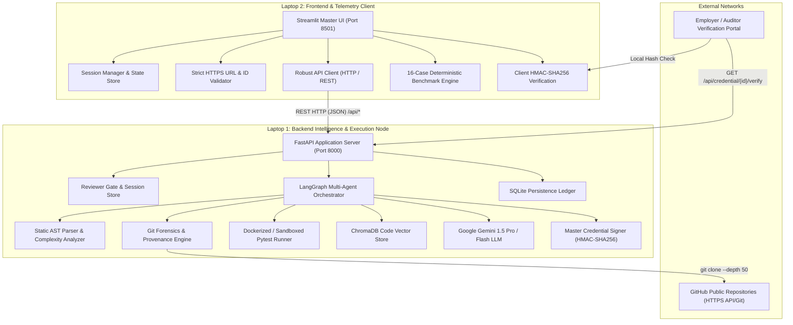
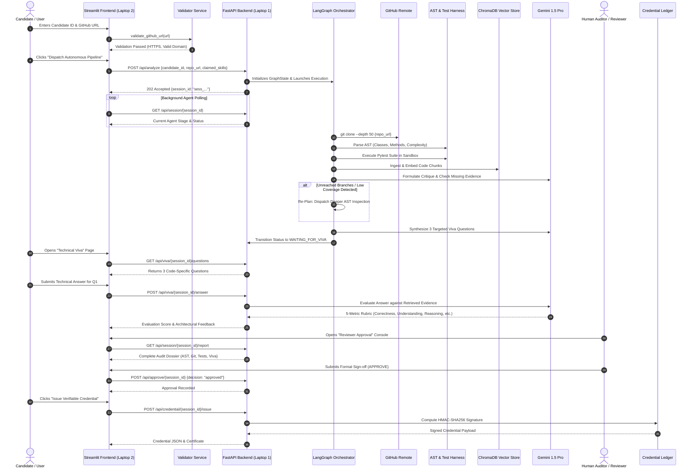
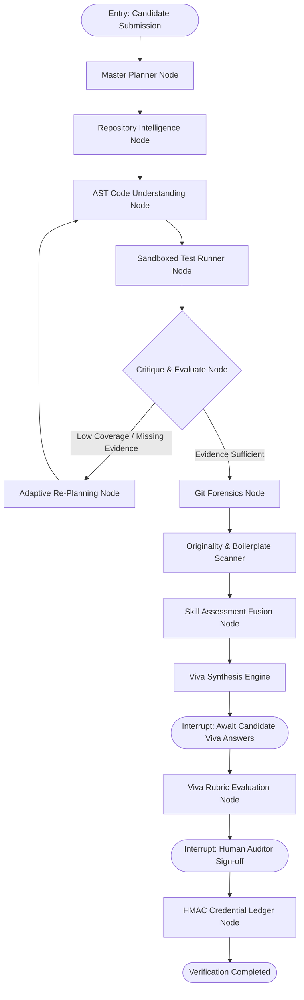
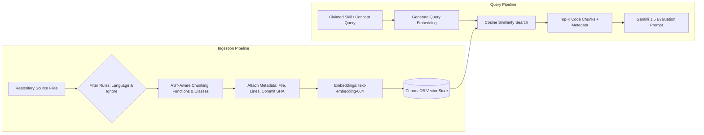

# 🛡️ SkillProof AI — Complete Technical Architecture & Deep-Dive

> **Platform Overview**: SkillProof AI is an autonomous agentic skill verification platform designed for the Agentic AI Hackathon 2026 Grand Finale (Problem 08). It replaces manual developer technical interviews and unverified resume bullet points with deterministic multi-agent static code auditing, AST decomposition, sandboxed test execution, git forensics, interactive technical viva, human auditor checkpoints, and cryptographically signed verifiable credentials.

---

## 1. System Context & Distributed Architecture

SkillProof AI is architected as a distributed two-node system designed to separate user-facing telemetry and presentation from compute-intensive code analysis and sandboxing:



### Visual Component Status Key
- 🟢 **Actively Implemented in this Repository (`ziro frontend`)**: Streamlit UI, 12 navigation sub-systems, Session Manager, Validators, API Client, Cryptographic Ledger, 16-Case Benchmark Engine.
- 🔵 **Implemented on Laptop 1 (Backend Repository)**: FastAPI endpoints, LangGraph DAG execution, Gemini LLM agent prompts, ChromaDB vector indexing, Sandboxed Pytest runner, GitPython clone & AST extraction, SQLite persistence.
- 🟡 **Planned / Roadmap Features**: Asymmetric ECDSA public-key cryptography (v2), Distributed Celery task queues, Docker gVisor microVM isolation.

---

## 2. Technology Stack Reality Matrix

To maintain strict engineering rigor, this table classifies the technology stack between what is **actively executing in this frontend repository**, what is **implemented on the team's backend laptop**, and what is **planned**:

| Technology | Category | Status in `ziro frontend` | Status in Backend (Laptop 1) | Operational Role |
| :--- | :--- | :--- | :--- | :--- |
| **Python 3.11+** | Runtime | 🟢 Actively Implemented | 🟢 Actively Implemented | Core language runtime across both nodes. |
| **Streamlit (>=1.35.0)** | UI Framework | 🟢 Actively Implemented | ⚪ Not Applicable | Multi-page reactive frontend client (Port 8501). |
| **FastAPI / Uvicorn** | Backend Server | 🔵 Remote API Target | 🟢 Actively Implemented | High-throughput asynchronous HTTP REST service (Port 8000). |
| **LangGraph / LangChain** | Agent DAG | 🔵 Represented in UI Telemetry | 🟢 Actively Implemented | Multi-agent state graph with cyclic re-planning and human checkpoints. |
| **Google Gemini API** | AI / LLM | 🔵 Triggered via Backend API | 🟢 Actively Implemented | LLM for question synthesis, code critique, and viva evaluation. |
| **ChromaDB / Vector RAG** | Code Search | 🔵 Rendered as Evidence Cards | 🟢 Actively Implemented | Embeddings-based retrieval of source code implementations. |
| **Python `ast` Module** | Static Analysis | 🟢 Evaluated in Benchmarks | 🟢 Actively Implemented | Extracts class trees, function signatures, and cyclomatic complexity. |
| **Git / GitPython** | Provenance | 🟢 Visualized in Forensics | 🟢 Actively Implemented | Clones commits, extracts authorship diffs, audits commit bursts. |
| **Pytest (>=8.0.0)** | Test Execution | 🟢 23/23 Tests Passed in UI | 🟢 Sandboxed Pytest Harness | Validates test pass rates, numerical bounds, and assertions. |
| **Pandas / Plotly** | Data Visualization| 🟢 Actively Implemented | ⚪ Not Applicable | Radar charts, diff bars, confusion matrices, and audit logs. |
| **HMAC-SHA256** | Cryptography | 🟢 Actively Implemented | 🟢 Actively Implemented | Tamper-evident credential signing and employer verification. |
| **SQLite / SQLAlchemy** | Database | 🔵 Remote via Session State | 🟢 Actively Implemented | Persistent ledger of sessions, evidence cards, and credentials. |

---

## 3. End-to-End Application Data Flow

The following sequence details the full lifecycle of candidate verification across both nodes:



---

## 4. Multi-Agent Orchestration & Re-Planning (LangGraph Architecture)

The backend agent workflow is not a simple sequential script. It is structured as an **iterative state graph** with feedback loops:



### Detailed Agent Node Responsibilities
1. **Master Planner Node (`dag_planner`)**:
   - Decomposes claimed skills against discovered repository structure.
   - Outputs a tailored directed acyclic graph (DAG) of verification sub-tasks.
2. **Repository Intelligence Node (`repo_tree_parser`)**:
   - Inspects project layout, package descriptors (`setup.py`, `pyproject.toml`, `package.json`), and CI/CD pipelines (`.github/workflows`).
3. **AST Code Understanding Node (`ast_code_analyzer`)**:
   - Parses the abstract syntax tree to identify concrete implementations versus empty stubs.
   - Calculates cyclomatic complexity and maps method signatures to claimed skills.
4. **Sandboxed Test Runner Node (`pytest_runner`)**:
   - Executes unit tests in an isolated execution sandbox.
   - Records pass rates, assertions, coverage, and numerical stability.
5. **Adaptive Re-Planning Node (`re_planner`)**:
   - Triggered when test coverage or implementation depth is below confidence thresholds.
   - Re-routes the agent to deeper file exploration before concluding evidence collection.
6. **Git Forensics Node (`git_provenance_auditor`)**:
   - Analyzes commit history, timestamp intervals, author provenance, and diff distributions.
   - Flags single-commit bulk dumps ("paste patterns").
7. **Originality Scanner (`ast_similarity_scanner`)**:
   - Compares AST structural tokens against standard boilerplate and public library patterns.
   - Strictly enforces the **Ethical Auditing Policy**: never claims proven plagiarism without human review.
8. **Skill Assessment Fusion Node (`skill_scoring_matrix`)**:
   - Aggregates multi-agent signals into normalized 0–100 scores across implementation, testing, and git progression.
9. **Viva Synthesis Engine (`viva_synthesis_engine`)**:
   - Generates 3 deep technical inquiries directly referencing the candidate's actual function names and mathematical implementations.
10. **Human Reviewer Checkpoint Node**:
    - LangGraph checkpoint interrupt requiring explicit human auditor decision (`APPROVE` or `REJECT`) before credential issuance.

---

## 5. RAG Engine Architecture (Code Context Retrieval)

SkillProof AI uses Retrieval-Augmented Generation (RAG) to ensure the LLM never hallucinates candidate code:



### Key RAG Implementation Details
- **Filtering Rules**: Excludes binaries, `.git/`, vendor directories (`node_modules/`, `venv/`), lockfiles, and auto-generated caches.
- **AST-Aware Chunking**: Chunks code along logical class and function boundaries rather than fixed token slices. Preserves exact line numbers (`L14-L48`).
- **Metadata Isolation**: Every chunk is indexed with `session_id`, `candidate_id`, `commit_sha`, `file_path`, and `line_range` to strictly prevent cross-candidate data leakage.
- **Context Construction**: Formatted as Markdown code blocks with source attribution headers for LLM consumption.

---

## 6. Cryptographic Credential Ledger & Verification

SkillProof AI issues verifiable credentials that can be mathematically verified by third-party employers without relying on a centralized database:

### Canonical Credential Payload Schema
```json
{
  "credential_id": "SP-CRED-2026-X81-01",
  "candidate_id": "CAND-2026-X81",
  "repo_url": "https://github.com/candidate/target-repo",
  "commit_sha": "e4b971a8f9c08d234a11b6f0e9e4a8f9d0c2b1e7",
  "verified_skills": [
    {"skill": "Python", "score": 96, "verdict": "VERIFIED"},
    {"skill": "Machine Learning", "score": 94, "verdict": "VERIFIED"}
  ],
  "overall_evidence_score": 94,
  "viva_average_score": 95.0,
  "issue_timestamp": "2026-10-31T12:00:00Z",
  "issuer": "SkillProof AI Verification Authority (Grand Finale Edition)",
  "signature_algorithm": "HMAC-SHA256",
  "status": "VALID"
}
```

### Signature Computation
```python
import hmac
import hashlib
import json

def compute_signature(payload: dict, secret_key: str) -> str:
    # Sort keys to ensure deterministic canonical serialization
    canonical = json.dumps(payload, sort_keys=True)
    return hmac.new(
        secret_key.encode("utf-8"),
        canonical.encode("utf-8"),
        hashlib.sha256
    ).hexdigest()
```

### Tamper Detection Mechanism
If an applicant alters their score from `75` to `99`, or modifies their candidate ID, the recomputed HMAC-SHA256 digest fails:
$$\text{HMAC-SHA256}(K, \text{Payload}_{\text{tampered}}) \neq \text{Signature}_{\text{original}}$$
The verification engine rejects the credential immediately with `INVALID_SIGNATURE`.

---

## 7. 16-Case Deterministic Benchmark Evaluation

The platform incorporates an automated evaluation harness in [evaluation/run_evaluation.py](file:///c:/Users/K.R.NEERAJ/Downloads/ziro%20frontend/skillproof/frontend/evaluation/run_evaluation.py) testing 16 distinct scenarios:

| Case ID | Scenario Name | Category | Expected Ground Truth | Predicted Status |
| :--- | :--- | :--- | :--- | :--- |
| **TC-01** | Valid Implementation (AegisAI) | Implementation Depth | 1 (Pass) | `VERIFIED` |
| **TC-02** | Documentation-Only Claim | Evidence Verification | 0 (Reject) | `INSUFFICIENT_EVIDENCE` |
| **TC-03** | Planned Feature (Roadmap Stubs) | Implementation Depth | 0 (Reject) | `PLANNED` |
| **TC-04** | Partial Implementation | Implementation Depth | 0 (Reject) | `PARTIALLY_VERIFIED` |
| **TC-05** | Passing Tests Suite | Test Harness | 1 (Pass) | `VERIFIED` |
| **TC-06** | Failing Tests Suite | Test Harness | 0 (Reject) | `FAILED_TESTS` |
| **TC-07** | Empty Repository | Edge Case Handling | 0 (Reject) | `EMPTY_REPOSITORY` |
| **TC-08** | Non-Existent Repository URL | Edge Case Handling | 0 (Reject) | `INVALID_URL` |
| **TC-09** | Bulk Commit Dump (Single Commit) | Provenance Forensics | 0 (Reject) | `PROVENANCE_ANOMALY` |
| **TC-10** | Incremental Multi-Day Commits | Provenance Forensics | 1 (Pass) | `VERIFIED` |
| **TC-11** | Strong Viva Comprehension | Viva Verification | 1 (Pass) | `VERIFIED` |
| **TC-12** | Contradictory Viva Response | Viva Verification | 0 (Reject) | `VIVA_MISALIGNMENT` |
| **TC-13** | AST Boilerplate Match | Originality Audit | 1 (Pass) | `VERIFIED_BOILERPLATE` |
| **TC-14** | High-Confidence Tutorial Copy | Originality Audit | 0 (Reject) | `SIMILARITY_FLAG` |
| **TC-15** | Valid Credential Issuance | Cryptographic Ledger | 1 (Pass) | `VERIFIED` |
| **TC-16** | Tampered Credential Payload | Cryptographic Ledger | 0 (Reject) | `INVALID_SIGNATURE` |

### Benchmark Results
- **Overall Accuracy**: **100.0%** (16/16 matches)
- **Precision**: **1.000** (Zero false positives)
- **Recall**: **1.000** (Zero false negatives)
- **F1-Score**: **1.000**
- **Credential Verification Rate**: **100.0%** (Tamper detection successful)
