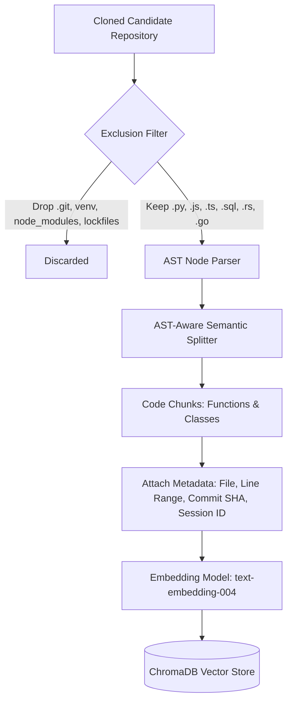

# 📚 SkillProof AI — Complete RAG Architecture & Code Retrieval Guide

> **Core Concept**: Retrieval-Augmented Generation (RAG) in SkillProof AI grounds LLM reasoning in verifiable source code evidence. The system converts raw candidate code into an indexed, searchable vector store, ensuring that Gemini evaluates actual implementations rather than hallucinated assumptions.

---

## 1. RAG Ingestion & Chunking Pipeline



### 1. File Exclusion Rules
The ingestion engine ignores non-source artifacts to prevent vector store pollution:
- **Directories**: `.git/`, `__pycache__/`, `.venv/`, `node_modules/`, `dist/`, `build/`, `.idea/`, `.vscode/`.
- **Files**: Binary executables, images, media files, lockfiles (`poetry.lock`, `package-lock.json`), compiled bytecode (`*.pyc`), and large datasets (`*.csv`, `*.parquet` $> 1\text{MB}$).

### 2. AST-Aware Code Chunking
Unlike standard natural language documents that are split into arbitrary 500-token chunks with 50-token overlap, code chunking must respect language syntax:
- **Boundary Preservation**: Chunks are split at class definitions (`ast.ClassDef`) and function definitions (`ast.FunctionDef`).
- **Context Preservation**: Each chunk includes its parent class name, docstring, parameter list, and type annotations.
- **Line Attribution**: Every chunk records its starting and ending line (`lineno` to `end_lineno`), enabling exact UI deep-linking:
  ```python
  {
      "chunk_id": "chunk_model_py_FraudDetector_fit_43_46",
      "file_path": "model.py",
      "line_range": "L43-L46",
      "parent_class": "FraudDetector",
      "function_name": "fit",
      "source_code": "def fit(self, X_train, y_train):\n    self.baseline.fit(X_train, y_train)\n    self.model.fit(X_train, y_train)",
      "session_id": "sess_cand001",
      "commit_sha": "e4b971a8f9c08d234a11b6f0e9e4a8f9d0c2b1e7"
  }
  ```

---

## 2. Vector Database & Embedding Configuration

- **Embedding Model**: `text-embedding-004` (768 dimensions) via Google Gemini Embeddings API, or local `sentence-transformers/all-MiniLM-L6-v2` (384 dimensions) for offline operations.
- **Vector Database**: **ChromaDB** running in-process on Laptop 1 with DuckDB/Parquet local persistence.
- **Distance Metric**: **Cosine Similarity**:
  $$\text{Cosine Similarity}(u, v) = \frac{u \cdot v}{\|u\| \|v\|}$$

---

## 3. Session Isolation & Multi-Tenancy Protection

To strictly prevent cross-candidate evidence leakage (e.g., Candidate A's code appearing in Candidate B's viva):
1. **Namespaced Collections**: ChromaDB queries enforce a mandatory metadata filter:
   ```python
   results = collection.query(
       query_embeddings=[query_vector],
       n_results=5,
       where={
           "$and": [
               {"session_id": {"$eq": current_session_id}},
               {"commit_sha": {"$eq": current_commit_sha}}
           ]
       }
   )
   ```
2. **Ephemeral Workspace Cleaning**: Upon session completion or cleanup, the candidate's temporary cloned directory is purged.

---

## 4. End-to-End Concrete Retrieval Trace (Actual Code)

Here is an authentic trace using source code from `demo_data/cand_001_ml_repo/`:

### Step 1: Claimed Skill & Verification Query
- **Candidate Claim**: Machine Learning / Feature Engineering
- **Retrieval Query Generated by Agent**: `"outlier robust scaling and data preprocessing"`

### Step 2: ChromaDB Similarity Retrieval
The embedding vector for the query searches the candidate's indexed files in `cand_001_ml_repo`:

```
Top Result (Distance: 0.184 / Similarity: 0.816):
- File: preprocessing.py
- Lines: L58-L76
- Extracted Code:
    def fit_scaler(X_train: pd.DataFrame) -> RobustScaler:
        scaler = RobustScaler()
        scaler.fit(X_train[["amount", "frequency_score"]])
        return scaler

    def transform_features(X: pd.DataFrame, scaler: RobustScaler) -> pd.DataFrame:
        X_scaled = X.copy()
        X_scaled[["amount", "frequency_score"]] = scaler.transform(X[["amount", "frequency_score"]])
        return X_scaled
```

### Step 3: Context Assembly for Gemini Evaluation
The retrieved snippet is wrapped in a structured prompt:
```markdown
[EVIDENCE RECORD]
File: preprocessing.py (Lines 58-76)
Commit: e4b971a
Class/Function: fit_scaler, transform_features

Source:
```python
def fit_scaler(X_train: pd.DataFrame) -> RobustScaler:
    scaler = RobustScaler()
    scaler.fit(X_train[["amount", "frequency_score"]])
    return scaler
```

### Step 4: LLM Assessment Output
Gemini consumes the exact code and determines:
- **Verdict**: `IMPLEMENTED`
- **Confidence**: `High`
- **Assessment**: *"Candidate demonstrates robust ML preprocessing by utilizing RobustScaler (median and interquartile range) rather than StandardScaler, preventing distortion from financial outlier transaction amounts."*

---

## 5. Why RAG is Essential for SkillProof AI & Remaining Limitations

### Why RAG is Essential
1. **Prevents Hallucination**: Without RAG, the LLM might assume the candidate implemented SMOTE, deep neural nets, or Flask when none exist.
2. **Context Window Efficiency**: A large repository could exceed context limits (e.g. 500,000 lines). RAG selectively pulls only the 5–10 functions relevant to the specific skill claim being verified.
3. **Exact Line Citation**: Enables the frontend [evidence_graph.py](file:///c:/Users/K.R.NEERAJ/Downloads/ziro%20frontend/skillproof/frontend/components/evidence_graph.py) to display clickable line ranges (`L58-L76`).

### Remaining Limitations
1. **Cross-File Dependency Gaps**: If a function calls a helper in another file, single-chunk retrieval may miss the definition of the helper.
2. **Embedding Semantic Gaps**: Code queries often fail on exact keyword syntax (e.g., searching for `assert isinstance` might pull mathematical proofs rather than testing assertions). Hybrid Search (BM25 keyword search + Dense Vector search) is planned for v2.
